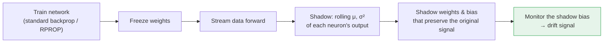
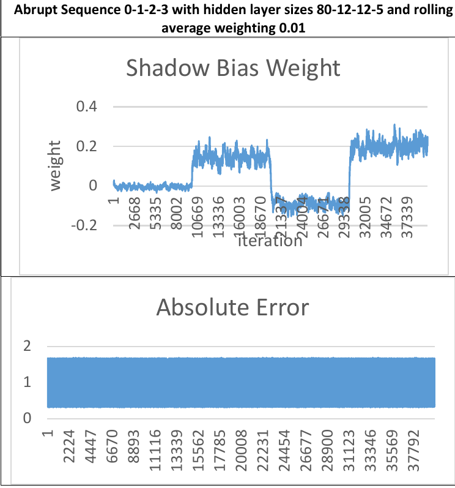
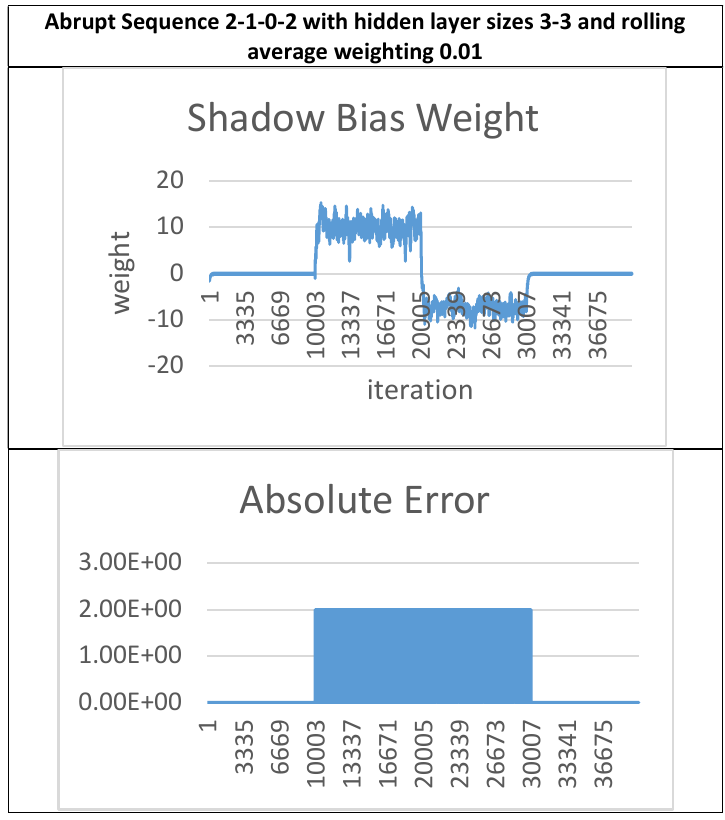

<div align="center">

# Monitoring Internal Covariant Shifts With Adjustable Standardized Weights

### Label-free drift detection by watching what happens *inside* a frozen neural network

**Charles (Chuck) de Sully**
Johns Hopkins University, Whiting School of Engineering

[](./docs/internal_covariate_shift_shadow_weights_desully.pdf)


</div>

---

## TL;DR

Models in production go stale when their input data drifts. Most drift detectors either need **labels**, which rarely arrive in time on a data stream, or watch the **raw inputs**, which misses how the model itself is responding to the change.

This paper takes a third route and monitors drift **inside the network**. After training, the network is frozen and a *shadow* mechanism is attached to each neuron. It tracks running statistics of the neuron's output and computes how the next layer's weights and bias *would have to change* to keep the signal identical if that output were standardized. The resulting **shadow bias** turns out to be a compact, label-free drift signal for an entire layer.

> **Headline result:** on the noisy SEA stream, the model's output error looks like constant noise from start to finish, yet the shadow bias steps cleanly at every drift point.

---

## The Idea

Batch normalization ([Ioffe & Szegedy, 2015](https://arxiv.org/abs/1502.03167)) standardizes hidden activations to *reduce* internal covariate shift during training. This work turns that idea around: instead of removing the shift, it **measures** it after deployment, without touching the model's behavior.



The real network keeps working exactly as trained. The shadow layer runs a "what if" scenario in which the signals between hidden layers are standardized.

### The math

For a neuron output $x$ feeding a downstream neuron with weight $\alpha$ and bias $c$, maintain exponentially weighted statistics:

$$
\mu_t = \lambda x_t + (1-\lambda)\,\mu_{t-1}, \qquad
\sigma_t^2 = \lambda (x_t - \mu_t)^2 + (1-\lambda)\,\sigma_{t-1}^2, \qquad
\hat{x} = \frac{x - \mu}{\sigma}
$$

Feeding $\hat{x}$ instead of $x$ would change the downstream signal. Because this part of the neuron is linear, there is a closed-form adjustment that cancels the standardization exactly:

$$
\alpha_1 = \sigma\,\alpha_0, \qquad
c_1 = c_0 + \sum_{w} \alpha_w\,\mu_w, \qquad
c_0 + \alpha_0\,x \;=\; c_1 + \alpha_1\,\hat{x}
$$

### Why watch the bias?

Each shadow weight reflects one upstream neuron. The shadow **bias**, however, accumulates $\alpha_w \mu_w$ across *every* neuron in the previous layer. It is effectively a learned, weighted projection of the whole layer's mean activity into a single number. That makes it:

- **A dimensionality reducer.** One scalar per node summarizes a layer that may be very wide.
- **Sensitive to collective behavior.** Shifts that individually look small can add up, while the trained weights determine which upstream neurons matter most.
- **Label-free.** It needs only forward passes on the incoming stream.

---

## Experiments

| | |
|---|---|
| **Data** | *Synthetic datasets for concept drift detection purposes* (López Lobo, 2020, Harvard Dataverse), built with scikit-multiflow |
| **Generators** | Stagger, SEA (20% noise), Sine, Mixed, Random Tree |
| **Stream** | 40,000 examples per set, binary target. Abrupt drifts at steps 10k / 20k / 30k; gradual drifts centered at 9.5k / 20k / 30.5k with a width of 1,000 |
| **Model** | RPROP-variant feedforward network, with depth and width matched to each generator's complexity (from 3-3 up to 80-12-12-5) |
| **Protocol** | Train on the first 9,000 examples (3 epochs, mini-batches of 100), **freeze**, then stream all 40,000 examples forward. Only the shadow statistics move. |
| **Rolling weight** | λ = 0.01 in most runs (0.001–0.01 explored) |

Every generator was tested with both abrupt and gradual drift, and with the concept sequence in both forward and reverse order.

---

## Results

### SEA (with 20% label noise): drift that the error signal cannot see

<p align="center">
  
</p>

The output error is uniform noise across the entire stream, so an error-based detector has nothing to work with. The shadow bias, by contrast, shows a distinct level for each of the four concepts, with transitions right at the drift points.

### Stagger: separating concepts that produce identical error

<p align="center">
  
</p>

With only a 3-3 hidden architecture, the shadow bias identifies all three drift points in the 2-1-0-2 sequence. Between steps 10k and 30k, the output error stays flat at the same level, but the shadow bias clearly separates concept 1 from concept 0 at step 20k. This is a transition that a detector based only on error would not flag.

### Summary across generators

| Generator | Features / noise | Outcome |
|---|---|---|
| **SEA** | 3 features, 20% noise | ✅ Clear steps at every drift point, despite uninformative output error |
| **Stagger** | 3 features, no noise | ✅ Clear boundaries with a minimal network. The 0-1-2-0 order blurs the 1→2 transition, while 2-1-0-2 separates all of them |
| **Sine** | 2 features, no noise | ◐ Partial. Later drifts are visible; the first is hard to find |
| **Mixed** | 4 features, no noise | ✗ The internal shift follows a different cycle than the output error and does not reveal the drift |
| **Random Tree** | 2 features, no noise | ✗ No discernible pattern, but frequency-like variation suggests a spectral transform could help |

The full set of plots for all 20 runs is in Section V of the paper.

---

## Findings

1. **Drift becomes clearer deeper in the network.** Early layers seem to act as noise filters. As the concept structure forms in later layers, disturbances to that structure stand out more.
2. **Internal signals can beat output signals.** On SEA and Stagger, the shadow bias picked up drift that output error either hid in noise or missed entirely.
3. **The method has clear limits.** Mixed and Random Tree drift did not show up in the shadow statistics. That is an honest negative result, and it points toward frequency-domain analysis of the shadow signal.

---

## Future Directions

- **Statistical alarms.** Feed shadow-weight variance into ADWIN, similar to Uncertainty Drift Detection, to turn the visual signal into an automatic trigger.
- **Localizing feature drift.** Use the non-bias shadow weights to trace which upstream neurons, and ultimately which features, are responsible.
- **Targeted retraining.** A node showing drift may need more training or extra capacity. Updating only the affected nodes could avoid full backpropagation through very large networks.
- **Spectral analysis.** Apply a frequency transform to the shadow-bias signal for drift types that look random in the time domain.

---

## About This Repository

This repository hosts the paper and figures. The original experiment code was exploratory and is not included. The method is fully specified by the equations above and Section III of the paper: a shadow layer is a few dozen lines on top of any feedforward network.

```
├── docs/
│   ├── internal_covariate_shift_shadow_weights_desully.pdf
│   └── figures/
└── README.md
```

---

## Citation

```bibtex
@misc{desully_shadow_weights,
  author      = {de Sully, Charles},
  title       = {Monitoring Internal Covariant Shifts With Adjustable Standardized Weights},
  institution = {Johns Hopkins University, Whiting School of Engineering},
  url         = {https://github.com/cdesully/nn-drift-shadow-weights}
}
```

## License
This work is licensed under a Creative Commons Attribution 4.0 International License.

## Related Work by the Author

- [**Predictive Geometry of Markets**](https://github.com/cdesully/ML_Research): a 114-page research journal on self-supervised world-models for financial time series, built on a frequency-domain representation of price.
- [**The Robovac Problem**](https://github.com/cdesully/RL_Roomba): a resource-constrained reinforcement learning environment studying how state-space design shapes generalization.
